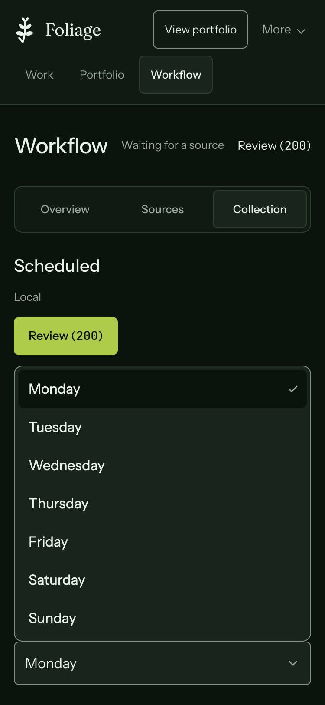
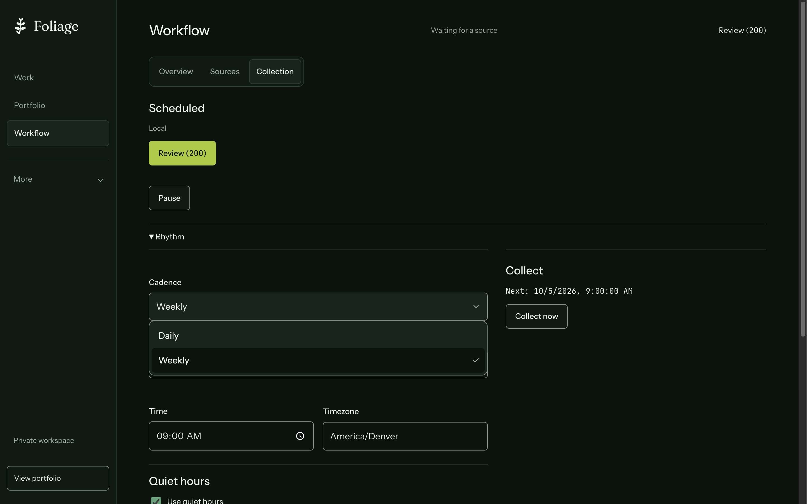

# Workflow Rhythm Select · bounded verification

Source commit: `61196d7` on `codex/radix-workflow-fields-20261001`. The local Leaf runtime served `/workflow#background` from this checkout on a verified free port, `43173`, using a disposable copy of 890 Leaflets and 200 review candidates derived from real repository history. No owner garden or hosted account was touched. The copy had no connected source, so the page truthfully showed “Waiting for a source.”

- Radix Select replaces the Rhythm form’s two native selects. It retains the existing schedule command and values. Daily hides Day; Weekly restores it. Keyboard Home then Enter changed Day from Friday to Monday; Save persisted Monday after refresh. Escape closed the listbox and returned focus to the Day trigger. Pointer selection of Daily also worked.
- True mobile emulation read back `innerWidth=375`, `(max-width:640px)=true`, and `scrollWidth=375`. The seven-option Day menu stayed within x=16–359px and y=421–739px of the 375×812 viewport. At desktop `innerWidth=1440`, the page had no horizontal overflow (`scrollWidth=1425`, including the scrollbar). Both loads had no browser console errors.
- On the night face, computed trigger text `rgb(233,240,234)` against `rgb(22,36,28)` measured 13.90:1; its `rgb(125,145,132)` border against the same ground measured 4.80:1. The selected indicator is an authored SVG, with no Unicode icon or shadow.
- `pnpm --filter @foliage/ui typecheck`, `pnpm --filter @foliage/leaf-app typecheck`, and `pnpm --filter @foliage/leaf-app workflow:build` passed. Impeccable `detect` on the changed UI files emitted no findings. Full `pnpm check` is recorded in the PR after completion.

The mobile crop is the top-left 750×1624 image pixels of the [unmodified Aside capture](mobile-raw.jpg), at deviceScaleFactor 2. Aside tiles the emulated page across its native capture width; the measured viewport and raw capture establish the layout. This verifies this component and form interaction, not all Workflow states, connected source intake, scheduled execution or release acceptance.
