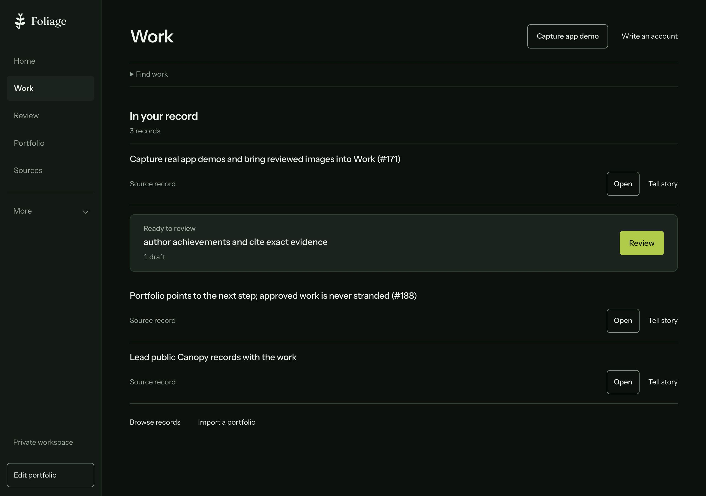
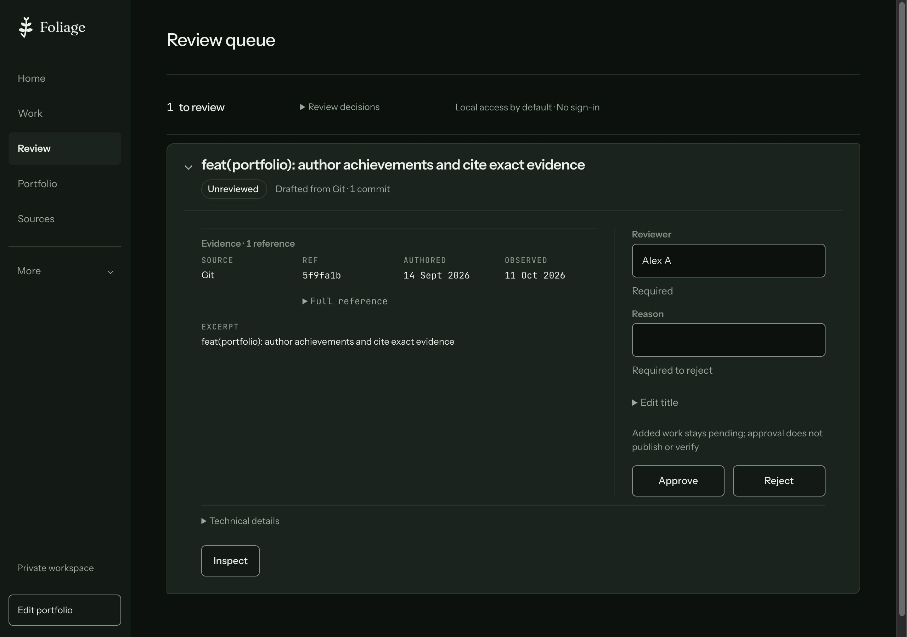

<h1 align="center">Foliage</h1>
<p align="center"><b>Your work deserves a record.</b><br>
A private, living account of what you built, decided and learned, with the evidence attached.<br>
Runs on your machine. Nothing is shared until you approve it.</p>

<p align="center">
<a href="LICENSE"></a>


</p>

<p align="center">


</p>
<p align="center"><sub>Real captures of the local app, not mockups. See <a href="apps/www/public/product/PROVENANCE.md">how they were made</a>.</sub></p>

## Try it in two minutes

You need Node 22.18 to 24, pnpm 11+ (`corepack enable`) and git. [bun](https://bun.sh) 1.3+ is only needed to build the browser bundles for `pnpm check` and a few screens.

```bash
git clone https://github.com/aacker71/foliage.git && cd foliage
pnpm install
node foliage.mjs grow --repo /path/to/your/repo --subject "Your name" --identity you@example.com
node foliage.mjs up
```

`grow` reads your git history and drafts candidate write-ups. `up` opens the app on `127.0.0.1`, where you
approve or reject each draft at `/review`. On a 1,300-commit repository `grow` took about 3 seconds in our check. Your data lives in `~/.foliage`, never in the checkout.
The full walk-through, including multiple git identities, is in [TESTER-QUICKSTART.md](TESTER-QUICKSTART.md).

## Why it is different

- **Evidence, not claims.** Every statement links to the commit or file it came from.
- **You decide.** Drafts are machine-made; nothing becomes part of your portfolio without your approval.
- **Local first.** No account, no server, no network calls while reading your repository.
- **No score.** Work is `verified`, `pending` or `excluded`, and those are unordered. An `excluded` item always says why.
- **Publish a slice.** A portfolio or résumé is a view you choose to share, and you can withdraw it.

## How it works

1. **Grow:** intake reads your work (git history first) into leaflets with their evidence.
2. **Review:** photosynthesis drafts candidates; you approve, edit or reject them.
3. **Share:** give one leaflet a shareable address, or publish a portfolio page. Rules you set decide what may leave.
4. **Search:** a local brain lets you, or an assistant you allow, find cited work in your record.

Current status and known limits are in [docs/STATE.md](docs/STATE.md). Developing Foliage? Start with
[DEVELOPMENT.md](DEVELOPMENT.md). Contributions are welcome under the [MIT licence](LICENSE); see [CONTRIBUTING.md](CONTRIBUTING.md).

---

# Reference

Start with the [product thesis](context/product-thesis.md).

## UI foundation

Foliage uses **Radix Primitives with Foliage-owned controls** in **@foliage/ui**, themed by
**@foliage/tokens**. Magic UI is reserved for purposeful website motion. Application adoption
is under review screen by screen. See [UI foundation and verified coverage](docs/UI-FOUNDATION.md)
and the [screen checklist](docs/UI-SCREEN-CHECKLIST.md).

The private [living compound leaf](docs/COMPOUND-LEAF-EXPLORER.md) adds a 3D,
artifact-linked explorer at `/leaf/explore`.

## Run it

**Changing the code?** Start with [the developer workflow](DEVELOPMENT.md): pinned setup,
watch mode, focused tests, and the same full gate locally and in CI.

For HRIS, learning, email/files and AI-assistant connections, see the
[integration roadmap and observation bridge](docs/INTEGRATIONS.md). Provider access and
live synchronization remain separate from importing selected records into review.
Local assistant hosts can use the [MCP connection](docs/ASSISTANT-MCP.md) to submit selected
observations, or import the text of an existing portfolio (`foliage_import_portfolio`), into the
same review queue.

**New here? Take the one quickstart:** [`TESTER-QUICKSTART.md`](TESTER-QUICKSTART.md) — from
clone to your exported portfolio open in a browser, on the garden path (`~/.foliage/`,
`node foliage.mjs grow → review → share <id> --as public → export`). Everything below is the
reference for the individual pieces underneath it.

Use the same `--garden <path>` (or `FOLIAGE_GARDEN`) throughout a session; it overrides
the default `~/.foliage`. The review queue is decided at `/review` in the app
(`node foliage.mjs up`); `review` prints its count and that address. Each launcher
command supports `--help` without changing files. First-use timing remains unmeasured.

Requires **Node 22.18–24** and **pnpm 11+** (`corepack enable` activates the pinned version),
plus `git` for intake and **bun 1.3+** for one browser bundle (see below; CI pins 1.3.14). The
downloadable app from getfoliage.com ships its bundles prebuilt, so people who install it
do not need bun. `pnpm install` must run once before anything else — the apps import
workspace packages that exist only as symlinks after install.

```bash
pnpm install
pnpm check
```

`pnpm check` runs runtime preflight, the public boundary gate, then egress, then the duplication/dead-export
gate, then findings, then typecheck, then the tests. If it is green, the tree is honest.
Node 22 runs the TypeScript sources directly via type stripping — the server code has no build
step and no `dist/`. The one exception is the browser bundles: `pnpm check` first runs
`pnpm run build:bundles`, which builds the Workflow screen with bun and the 3D leaf and portfolio
views with Node. Without bun, `pnpm check` stops at once with `bun: command not found`, and a
server started from a clean checkout shows the Workflow screen as not built.

`pnpm verify [surface]` (`tools/verify`) boots a surface, drives it in a real browser, and
reports one structured verdict per check — a `PASS` line names the value it measured, a `FAIL`
line is actionable, and a surface whose server would not boot reports `BOOT-FAILED` rather than
"0 problems". `pnpm serve up` keeps every surface running for looking at by hand, independent of
the shell that started it; `status` and `down` manage only this worktree's supervised children.
Use `--port-offset N` with `serve up` and `verify` for parallel worktrees. Verification leaves
its servers running for inspection; `pnpm serve down` stops them, without touching browser tabs.

### AI engineering and observability

Run `pnpm ai:up` and `pnpm ai:provision` for the local Dify Photosynthesis evidence lab. Ladybug is the cloud-only product.
`pnpm ai:eval --packet /path/to/reviewed-export.json` validates the selected packet;
adding `--send` runs the pinned workflow against local Ollama and retains its node trace
in local Dify. `pnpm ai:report` summarizes recorded outcomes and latency.
See [the development workflow, privacy boundaries and troubleshooting](docs/AI-ENGINEERING.md).

### Self-host one leaf — lower-level entry point

```bash
node apps/leaf/server.mjs                                  # http://127.0.0.1:4174
FOLIAGE_LEAF=/path/to/leaf.json node apps/leaf/server.mjs  # or point it somewhere
PORT=4175 node apps/leaf/server.mjs                        # if 4174 is busy
```

After `pnpm install` installs the workspace and declared dependencies, a JSON file and
`node` run the server directly. Shared shadcn controls use React on the server; Leaf pages need no browser
bundle. The Workflow screen and the 3D views do: run `pnpm run build:bundles` once first. Published documents remain script-free. With no document present
it says so and names the path it searched — a valid document with **no leaflets** is a
different state and says something different, because an empty portfolio is not a missing one.

`apps/leaf/example/leaf.example.json` illustrates the document format. It is loaded only when
`FOLIAGE_LEAF` names it explicitly, and any document it loads renders under a permanent
*example document — not real evidence* band. The bare server defaults to the gitignored
`apps/leaf/leaf.json`; it does **not** choose the launcher's garden. To browse the same data
as `grow` and `review`, use `node foliage.mjs up`, or explicitly set `FOLIAGE_LEAF`,
`FOLIAGE_HARVEST` and `FOLIAGE_POLICY` when calling the lower-level server. Keep personal
documents outside this checkout and never commit them.

### Share one leaflet

Every leaflet has its own address, `/leaflet/<id>`, and by default that address answers as
though nothing were there. **Private is the default and it is expressed by the field's
absence**, so a document nobody has edited shares nothing — measured on a fresh intake of this
repository, all 68 leaflets were private and all 68 addresses answered 404, which is the
correct result rather than a broken one. This count grows every commit; re-derive it rather
than copy it forward.

```bash
node apps/leaf/share.mjs list                                   # what is shared, and what is private by default
node apps/leaf/share.mjs share <id> --leaf /path/to/leaf.json    # unlisted: whoever holds the link may read it
node apps/leaf/share.mjs share <id> --as public --leaf /path/to/leaf.json  # additionally may be listed outward
node apps/leaf/share.mjs unshare <id> --leaf /path/to/leaf.json  # the address goes back to answering as empty
```

Two words rather than a boolean, because being willing to hand someone a **link** is a
different consent from being **enumerated**. `unshare` deletes the field rather than writing
`"private"`: the default has exactly one spelling, and a second one would make two documents
that mean the same thing stop comparing equal.

`share`/`unshare` require `--leaf` (or `FOLIAGE_LEAF`, same as the server above) explicitly —
this is the one write on this surface that can turn something exposed, and the command never
guesses which document that is (F-025). `list` still defaults to the leaf beside this script,
because reading the wrong one by accident prints a confusing list, never a write.

It is a command and not a button on purpose. The server has no authentication of any kind — it
binds loopback and treats anyone who can reach the port as the subject — and the one decision
here that widens who may read somebody's evidence does not belong on an unauthenticated
surface. The terminal already answers *is this the person* with the filesystem's permissions.

A leaflet that does not exist and a leaflet that has not been shared get the **same** answer,
so nobody can learn that an id exists by trying ids. The subject learns it from their own leaf,
which says why each row has no link.

### The publish policy — rules, not a model, and you adjust them by example

Sharing is your act. The **publish policy** is the rail around it: a document of rules, evaluated
every time something is asked for, with **no model anywhere near the decision**.

```bash
node apps/leaf/policy.mjs show                    # the rules in force, and which file they came from
node apps/leaf/policy.mjs check                   # what happens at every leaflet's address, and why
node apps/leaf/policy.mjs deny  <id> --by evidence-ref  --because "…"
node apps/leaf/policy.mjs allow <id> --by evidence-source --because "…"
node apps/leaf/policy.mjs drop  <rule-id>
```

`deny`/`allow` take **one of your own leaflets as the example** and read the fact off it — a tier,
an evidence source, a ref, an id prefix. That is what "adjust it by example, in chat" compiles to:
a model may draft the rule and write your sentence into `--because`, and what lands in the file
names something already written in your document. Nothing interprets anything later, so the same
leaflet gets the same answer from anyone who runs it, and every refusal can be explained by
quoting a line of your own file. The match vocabulary is closed by the parser, which is precisely
what stops *"is this sensitive?"* from ever becoming a rule.

The two effects are **not** mirror images, and that asymmetry is the whole design:

- **`deny` is absolute.** It is evaluated at publish time and it beats your own share — a leaflet
  you marked `public` and a rule denies answers as though nothing were there. Measured on a real
  intake of this repository: `share.mjs share <id> --as public` made the address answer `200`, and
  `policy.mjs deny <id> --by evidence-ref` made the same address answer `404` on the same running
  process, with `share.mjs list` still correctly reporting `public` — the rail overrode the act, it
  did not rewrite it.
- **`allow` only proposes.** A matching allow rule puts a leaflet on `check`'s candidate list. It
  publishes nothing; `share.mjs` is still the act.

So a rule you get wrong can only ever cost you visibility, never cause exposure.

With no policy file, the **shipped default** is in force — four rails and one proposal: no
`excluded` work (that is somebody else's), no third-party-shaped evidence, no rating-shaped title,
nothing with no evidence at all; and `verified` work is proposed. The default proposes nothing on
this repository's own history and says why: nothing here is `verified`, because this machine can
check no signature. A rating-shaped title is denied even when it is a real engineering figure —
`perf: cut p99 by 40%` is refused, and that cost is accepted rather than discovered later.

A policy file that **exists and does not parse** is a hard failure, not a fallback: the server
answers `503` on every route and names the file and each problem. Falling back to the shipped
default at the moment your own rules break would swap them for something possibly *looser*, which
is the one direction that cannot be undone.

The canopy publisher applies the same policy document again at the egress boundary. An absolute
deny withholds a verified leaflet; an allow or no-match still cannot publish anything by itself.
The leaf id must be typed at the final publication step, and an existing publication requires a
separate replacement decision. A malformed policy is a hard failure and writes nothing.

### Manage one local publication

```bash
node foliage.mjs canopy
# private manager: http://127.0.0.1:4180/
# read-only public server: http://127.0.0.1:4173/leaf/<leaf-id>
```

The two surfaces are separate processes because they have opposite authority. The private,
loopback-only manager can invoke the existing publish and withdraw commands after a typed-id
confirmation. The public server has only `GET` and `HEAD`; it reads the resulting artifact on each
request and has no mutation route, account credential, model client, tracker, or background sync.
The manager shows the complete deterministic review before the decision, including every item
that remains private and the limits of the redaction mechanism. See
[`docs/CANOPY-CLOUD.md`](docs/CANOPY-CLOUD.md) for the journey and agent boundary.

The current frozen public artifact carries eligible verified titles and provenance, not
rich local bodies/media or pending drafts. It may honestly be empty. These loopback
processes do not implement hosted account admission or a deployed managed service.
Separately, `node foliage.mjs export` writes a static copy: copies distributed elsewhere
cannot be centrally withdrawn. Managed hosting requires its own ownership, durable
status/withdrawal and US-storage acceptance before customer use.

### Evidence intake — where leaflets come from

```bash
node apps/leaf/intake.mjs --repo <path> --subject "<name>" --identity <email>
```

Reads real commit history with `git log` and writes a leaf document. `--identity` is repeatable,
because a real person has a work address, a personal one and a forge noreply, and omitting one
would exclude their own commits. Writes to `apps/leaf/leaf.json` unless `--out` says otherwise,
and refuses to overwrite an existing document without `--force`.

Tiers come from real git signals and nothing else:

| tier | means | assigned when |
| --- | --- | --- |
| `verified` | authorship is cryptographically established | a declared identity **and** a signature git accepted **and** a signer git bound to one of those identities |
| `pending` | attributable, but not proven | a declared identity, and a signature that is absent, unchecked, unbound, made by someone else, or rejected |
| `excluded` | could not be attributed to this subject | the author identity is not one that was declared |

**A matching author email is never enough to verify.** `git config user.email` is a string
anyone can set to anyone, so a matching address yields `pending`; only a signature says who
wrote a commit.

**A signature git accepted is not enough either — it has to be the subject's.** git reports the
signer it actually bound in `%GS`, and reading only the verdict beside it produced a false
`verified`: measured with git 2.54.0, one `allowed_signers` line binding a key to
`someone@else.example`, on a commit authored `subject@example.com`, gives `%G?` of `G` and `%GS`
of `someone@else.example`. In an ordinary team that file holds several colleagues' keys, so any
of them could author as the subject. The signer is read from the same `git log` — it costs no
extra call — and compared to the declared identities; a signature with no signer, or with
somebody else's, stays `pending`.

**`git log --format=%G?` alone is not enough either, and this is measured.** When git cannot
run the signature checker it prints `N` — its code for *there is no signature* — on stdout and
sends the real cause to stderr. On a machine with no `gpg` and no `gpg.ssh.allowedSignersFile`,
`%G?` reports `N` for all 1,930 commits of one real repository while 298 of those commits
carry a real signature in their objects (295 SSH, 3 PGP). Reading only the verdict, intake would
have asserted unsigned history it never checked. So it also reads what each commit **object**
holds (`git log --pretty=raw`, measured at 0.03s against 0.34s for the read it augments) and
probes what the machine can check — `gpg.program` and `gpg.ssh.program`, whether each runs, and
`gpg.ssh.allowedSignersFile`, whether it exists. Both backends, because git uses two and either
can be broken alone: with `gpg.ssh.program` pointed at a path that does not exist, git returns
`B` — its code for a *bad* signature — about a cryptographically perfect one, and a caller
reading only that verdict reports "checked and did not accept" about a check that never ran. No
stderr text is matched anywhere — that string changes with git's version and locale; an armor
header does not. Both reads also pass `--no-show-signature`, because `log.showSignature` is a
setting a developer may have on and it rewrites both of them out from under the parser.

The signature findings therefore sit *beside* the tier rather than inside it, because the tier
set is FCRA-scoped and a fourth tier would change what the product claims about people:

| finding | means | tier |
| --- | --- | --- |
| verified | git accepted the signature and bound it to a declared identity | `verified` |
| unsigned | the object carries no signature and git agrees | `pending` |
| unchecked | the object carries a signature **nobody checked** | `pending` |
| unbound | git accepted it and named no signer to bind (`%GS` empty, or no address in it) | `pending` |
| undeclared | git accepted it and the signer is **somebody else** — a real signature, not this subject's | `pending` |
| rejected | git checked and did not accept: bad, expired, revoked | `pending` |
| unrecognized | a `%G?` code this version does not know, claimed to be neither checked nor not | `pending` |

Intake prints each of these separately and names the remedy — install `gpg` for PGP, configure
`gpg.ssh.allowedSignersFile` for SSH, declare the address with another `--identity` if the
signer really is the subject. It says *0 verified is the correct result for unsigned history*
only when nothing went unchecked, unbound, undeclared or rejected; otherwise that sentence would
be a confident claim about commits nobody read.

An `undeclared` signer does **not** make a commit `excluded`. Those are two different facts about
one commit: `excluded` says the work is somebody else's, and a commit the subject authored and a
colleague signed is attributable, simply not proven. The signer's address is never printed —
`git verify-commit <ref>` shows it to whoever may read the repository.

Exclusion reasons name the commit but **never the other author's email address**, because the
leaf page renders them publicly and the subject can read their own repository.

Intake never writes a document from a failed read. If git is missing, the path is not a
repository, or the output cannot be parsed, it names the cause and exits non-zero — a
zero-leaflet file written after a failure would be indistinguishable from an honestly empty
portfolio. A repository with no commits *is* an honest empty portfolio, and that case succeeds
with zero leaflets.

## The taxonomy

The hierarchy is botanically exact, not a loose metaphor, and the code uses the same words:

| Term | Is | Type | Plane |
|---|---|---|---|
| **Canopy** | the public layer, formed by many trees' crowns | `Canopy` | cloud |
| **Tree** | a company — the whole organism | `Tree` | cloud / enterprise |
| **Bough** | an organization: a main limb off the trunk, i.e. a business unit | `Subject` | enterprise |
| **Branch** | a team: a division of a bough | `Subject` | enterprise |
| **Leaf** | one person's portfolio | `Leaf` | **open** |
| **Leaflet** | one artifact of evidence within a portfolio | `Leaflet` | **open** |

Every link is a real botanical containment, and that is the test a word has to pass to get in
here. A leaflet is a subdivision of a compound leaf, so "a leaf is composed of leaflets" is
literally true. A branch is a division of a bough and a bough is a limb of a tree, so "a branch
belongs to a bough, which belongs to a tree" describes one organism throughout — where "a team
belongs to an organization, which belongs to a company" was an org chart borrowed into a
botanical metaphor and true only by convention. The mark draws the same structure: a
**bipinnate** leaf's rachis carries pinnae and each pinna carries leaflets, which is bough →
branch → leaf at the logo's own scale.

The two ends of the hierarchy are load-bearing rather than decorative:

- **The leaf level is the open plane's actual `Leaf`.** `@foliage/photosynthesis-enterprise`
  imports `LeafId` from `@foliage/leaf` rather than declaring an "individual" of its own, so a
  customer's org chart terminates in an object the person it describes already owns and can
  self-host.
- **Bough and Branch exist only in the enterprise plane.** Nothing in `cloud` consumes a
  company's internal structure, and this repository does not ship plumbing that only matters
  once future data arrives — so `@foliage/canopy` models Canopy, Tree and Leaf, and stops.

`Branch` here is not git's branch. Capitalized `Branch`/`BranchId` is this taxonomy; git's is
always lowercase and in context (`git branch`, `--initial-branch=main`). They occur in no file
together — the taxonomy's lives only in the enterprise plane, git's only in the open plane's
intake code.

## Layers: the leaf stands alone

Packages sit in three layers, declared in [`public-boundary.json`](./public-boundary.json).
Everything is MIT; the layers exist to keep the leaf self-hostable by itself.

- **`open`** — the compound leaf. One person's portfolio and the leaflets of evidence it is
  composed of. A leaf belongs to the person it describes, so the code that models it is
  something they can read, run, fork and self-host without asking anyone.
- **`cloud`** — gathering many people's leaves into trees and a browsable canopy. Tenancy,
  indexing, discovery, billing, egress.
- **`enterprise`** — internal portfolios at every level of the hierarchy: leaves (individuals),
  branches (teams), boughs (organizations) and whole trees (companies), plus the company policy
  governing outward release.

The `open` layer must **stand alone**: a checkout holding only those packages has to be a
working product. This is enforced mechanically:

```
pnpm check:boundary
```

[`scripts/check-public-boundary.mjs`](./scripts/check-public-boundary.mjs) fails the build if
anything in `open` reaches anything outside it, through a declared dependency or an import in
source. `cloud` and `enterprise` may depend on `open`, never the reverse. CI asserts the gate
rejects a deliberately introduced violation, so it cannot decay into a no-op.

## The capability ledger is checked mechanically too

```
pnpm check:ledger
```

[`docs/STATE.md`](./docs/STATE.md) is the current state. [`.loop/STATUS.md`](./.loop/STATUS.md) is a
historical capability ledger, [`.loop/MILESTONES.md`](./.loop/MILESTONES.md) the release plan as of
2026-10-01, and the [progress tracker](./context/progress-tracker.md) holds dated verification. The ledger
has been wrong four separate times — every time because **a number was copied instead of
re-derived**, or a row was not re-checked after the code under it changed.
[`tools/ledger/check.mjs`](./tools/ledger/check.mjs) turns that discipline into a gate. It
resolves each row to a file scope and asks git whether that code changed after the row's
`last verified` date; it re-derives the test counts rows cite and compares; it finds workspace
packages nothing outside themselves consumes; and it checks each row against the vocabulary
the ledger itself declares.

Three properties are the point. It **never edits the ledger** — a tool that rewrites a historical source record to make itself pass is the corruption the ledger exists to refuse. It **never
emits a number it cannot stand behind**: a count it cannot derive exactly is reported as
un-derivable, and `--verify-tests` re-runs the real suite to prove the fast derivation still
matches. And a row it cannot map to files is printed as **UNMAPPED**, never as passing —
"unchecked" and "verified" are different words.

It is deliberately **not** part of `pnpm check`. The ledger describes work; the gate reports
where the description has drifted, and a human decides what the row should say.

## Packages

| Package | Plane | What |
|---|---|---|
| `@foliage/tokens` | **open** | the design system — colour, type, space, motion, the mark |
| `@foliage/leaf` | **open** | the compound leaf: a portfolio, its leaflets, proof tiers, the attribution ledger, and the leaf-document format |
| `@foliage/photosynthesis` | **open** | drafting leaflet **candidates** from real material on your own machine, reviewing them by hand, and promoting only the approved into a leaf |
| `@foliage/leaf-app` | **open** | `apps/leaf` — the self-hostable single-portfolio renderer, plus `intake.mjs` and `harvest.mjs` |
| `@foliage/photosynthesis-app` | **open** | `apps/photosynthesis` — historical standalone collector and review server; the current garden queue is Leaf `/review` |
| `@foliage/canopy` | cloud | trees and the canopy they form — the hosted aggregation layer |
| `@foliage/canopy-app` | cloud | `apps/canopy` — the read-only public canopy and a separate local manager for publication review, replacement, and withdrawal |
| `@foliage/escalated-inference` | cloud | the Tier 3 escalated-inference client — a frontier model drafts candidates for human review, never writes a leaflet itself; built, consumed by nothing yet |
| `@foliage/enterprise-policy` | enterprise | the internal → public release state machine |
| `@foliage/photosynthesis-enterprise` | enterprise | the same drafting at organizational scale: artifacts belonging to a tree, a bough, a branch or a leaf, governed outward by the release machine |
| `@foliage/enterprise-app` | enterprise | `apps/enterprise` — the org chart (boughs and branches) and the release decisions that gate what reaches the public canopy |

## Two constraints that shape the code

**No score, ever.** `ProofTier` is deliberately unordered: there is no comparator and no
numeric mapping anywhere in `@foliage/leaf`. An ordered tier invites a weighted
aggregate, and a weighted aggregate is a score. Under the FCRA posture this product never
shows a score to an employer, so the types refuse to make one convenient. The
attribution ledger returns per-tier **counts** and never a ratio.

**Excluded is not an error.** Work that cannot be attributed to the subject is reported as
`excluded`, *with a required reason*, rather than dropped or counted as theirs. The reason
field is mandatory in the type, because the previous system collapsed four distinct causes
into `commitCount: 0` and then asserted "0 commits" about work it had never read.

## Licence

[MIT](LICENSE) for the whole repository. See [LICENSING.md](./LICENSING.md) for a
plain summary and [CONTRIBUTING.md](CONTRIBUTING.md) for how to contribute (DCO sign-off, no CLA).
Report security problems privately: [SECURITY.md](SECURITY.md).
