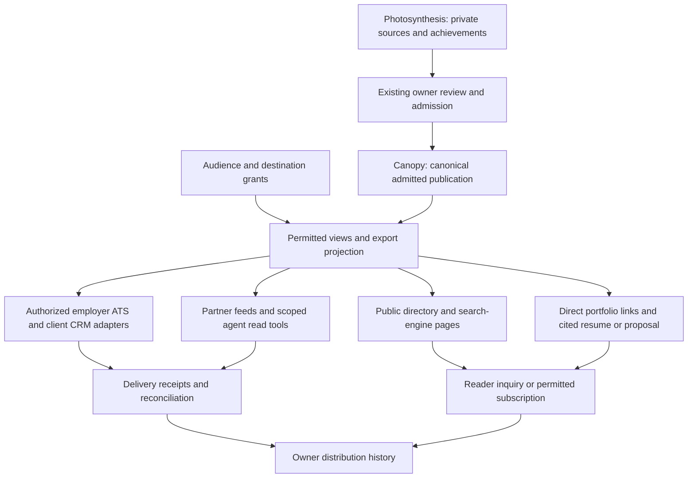

# Portfolio distribution and opportunity discovery

Status: implementation design, 2026-09-23. Requested by the owner for Juicebox and the wider
recruiting, hiring-manager and client ecosystem. This contract extends Canopy; it does not
claim deployed integrations, supplier agreements, indexed profiles or delivered introductions.
Canonical ownership: [architecture](../architecture.md). Build units: [35](../specs/35-distribution-core.md),
[36](../specs/36-destination-adapters.md), [37](../specs/37-partner-feeds.md).

## 1. Outcome and product boundary

A person chooses the work and opportunities they want to be known for. Foliage helps the
right recruiter, manager or prospective client encounter an understandable account, follow
its supporting evidence, and request a conversation. A portfolio must be usable without
WebGL, a Foliage account or a vendor-specific integration when its audience is public.

Architecture coverage means a supported path for each destination class, not an assertion
that every recruiting product accepts arbitrary third-party data. Ship a capability matrix
and truthful fallbacks. A link copied, document downloaded, API request accepted, profile
indexed, page requested and conversation started are different outcomes.

Foliage maintains the person's account and evidence provenance under the person's control. It does not compute candidate
scores, order proof tiers, rank people, infer protected characteristics, decide who should be
hired, or equate activity volume with capability. Claim support is distinct from independent
verification of attribution and results.

## 2. One publication model, four delivery paths

- **Discover:** opt-in Foliage listings, public HTML, structured metadata and sitemaps;
  useful before any vendor agrees to integrate. Indexing is not guaranteed.
- **Share:** job-specific or client-specific views, cited resume/proposal downloads and
  links for application forms, introductions and proposals. Creating a package does not send it.
- **Deliver to a customer system:** an authorized employer or client connects its own ATS/CRM.
  A job seeker cannot grant API access to an employer's account.
- **Supply a platform:** a data agreement admits an explicit cohort to a supplier feed.
  Juicebox is the first proposed partner; paid MCP usage is a separate entitlement.

All paths select the same stable achievements and statements. There is no parallel recruiter
resume, copied capability graph, new ATS, or separate client portfolio database. A recipient
view changes selection and presentation; factual text changes return to canonical authoring.

## 3. Ownership and implementation seams

| Existing owner | Extension and boundary |
|---|---|
| Photosynthesis / local Leaf | Gather authorized sources, maintain achievements/citations, propose selections; retain private originals |
| `packages/canopy` | Pure projection of admitted publications into distribution views and export envelopes; no provider SDK or secrets |
| `apps/canopy` | Clerk-authenticated consent, recipient access, listing/search, export/feed endpoints, destination operations and inbound inquiries |
| Existing Supabase authority/object store | Reuse publication heads, immutable digests, generations, grants, receipts and outbox; add destination-specific relations |
| Existing hosted workers | Dispatch distribution operations using the same transaction/outbox/lease principles; domain operations remain distinct from notification sends |
| Existing Nango integration | Extend actor/tenant-bound connection management for authorized external destinations; isolate source-read and destination-write scopes |
| Existing Novu integration | Permitted owner/recipient notices and digests, never the portfolio store or evidence transport |
| Scarlet, cloud-side | Propose a supported destination/view/introduction and explain missing evidence; calls the same gated operations |
| Jev / TypeSafe | Optional bounded classification and claim-support assistance after applicable cloud-transfer consent; never grants authority |

No change to open/cloud/enterprise licensing planes. Initial distribution exports use currently
admitted public material only. Recipient-specific publication of otherwise private material is
a separate admission extension requiring recipient identity and access acceptance; a view is
never a back door into private Leaf bytes. Enterprise disclosure policies remain in force.

## 4. Person and reader journeys

The owner sees an **Opportunities** area in the existing portfolio, not a connector dashboard.
They choose jobs, consulting/client work, or both, with optional role/service, location/work
mode, availability and contact preferences. These are owner declarations, not inferred facts.

The primary actions are **Be discoverable**, **Share for an opportunity**, and **Connect a
destination**. A short review shows the actual audience, selected work, destination, update
behavior and any external-copy limitation. Advanced settings disclose scopes, cadence and
receipt details. Routine updates within a valid standing grant need no repeated form filling.
New recipients, broader fields, changed purpose or material outside the approved scope require
new authority. An explicit standing grant can cover future admitted updates within its scope. Configuring a preference never sends an introduction.

An achievement selection creates a view referencing canonical IDs. A hiring view leads with
relevant contribution and evidence; a client view leads with services, related outcomes and
case studies. Both preserve collaborators, AI assistance and qualifications. The compound-leaf
portfolio remains the deeper reading experience; evidence and plain text remain accessible.

Readers get a short account, selected achievements, evidence links, freshness dates and a clear
**Request a conversation** action. A public reader can inspect public content without sign-in.
Private reader access uses verified identity. An inquiry uses rate limits, abuse controls and
sender verification before notification; private owner email is never exposed by default.
Reader forwarding does not confer access to a restricted view.

A manager can share a public achievement link in a hiring discussion. A recruiter can save a
permitted view into an authorized ATS. A client can include an admitted case study in its CRM
or proposal process. These are separate purposes and grants, not a universal recruiter flag.

## 5. Identity, grants and recipient rules

Reuse the existing grant and consent model rather than a second permissions engine. A
`DistributionGrant` references subject/controller, selected publication or view, permitted
fields, audience, destination connection/partner/tenant, purpose, expiry, update mode,
publication generation and policy version. Scope includes whether citations, attachments,
contact methods and onward redistribution are permitted.

Separate permissions cover:

1. Public publication and optional search-engine indexing.
2. Foliage directory listing and optional partner discovery.
3. A named recipient, employer account, client account or partner cohort.
4. One-time delivery versus replacement updates within the same approved scope.
5. Subscriptions, notifications, introductions and job applications.

No inherited grant from OAuth, payment, public availability, recruiter account, employer
membership or an AI decision. The existing publication gate stays authoritative. The owner's
approved-project automatic-publication direction requires durable publication grants before
activation; distribution grants alone cannot publish new private achievements.

Issuer subject IDs, tenant IDs, destination candidate/contact IDs and the person's Foliage ID
remain distinct. Keep a destination-scoped opaque external ID plus a validated identity link.
Use existing destination mappings first. Ambiguous matches require resolution; never merge on
name alone or create a duplicate because a lookup timed out. Contact email is optional and
separately consented. Only the authorized employer administrator grants employer API access.

Public search can be indexed and copied externally. Unlisting cannot erase downloaded copies
or guarantee search-engine removal. Private views are authenticated and `noindex`; robots rules
are not access control. Blocking an employer is enforceable only in identity-controlled paths,
not a secrecy guarantee for a public portfolio.

## 6. Proposed data and interface contracts

Reuse hosted actor/tenant-scoped tables and receipt infrastructure. Add migrations, never
standalone JSON state in the cloud or duplicate queues.

| Relation | Minimum durable facts |
|---|---|
| Distribution view | Subject, publication digest/generation, stable selected achievement/claim IDs, audience, presentation preset, view revision |
| Opportunity preferences | Owner-supplied goals, services/roles, availability, contact preferences and visibility scope |
| Destination connection | Existing Nango connection reference or partner client, owning actor/tenant, supported capability version and entitlement status |
| Distribution grant | Existing grant reference plus destination/purpose/fields/update-mode restrictions |
| Destination binding | Scoped external ID, provider tenant + record ID, verified mapping provenance, last confirmed delivered digest/generation |
| Distribution operation | Existing operation receipt/outbox relation plus action, approved payload digest, grant version, adapter version, attempt/fence and reconciliation state |
| Partner checkpoint | Client/cohort/filter scope, monotonic cursor, acknowledged generation, expiry and reconciliation requirement |
| Inquiry/subscription | Verified sender, intended subject/view, purpose, opt-in preferences, abuse state; independent of destination credentials |

A versioned `foliage-distribution` envelope is a projection referencing the existing published
document format, not a replacement evidence schema. It includes a destination-scoped subject
key, canonical permitted URL, publication/view digests, generation, updated time, declared
profile fields, selected achievement/claim IDs and text, citations and support limitations.
Permitted media use controlled links or explicitly admitted attachments. Employer-private URLs,
local file paths, reviewer notes, transcripts and unselected excerpts never enter exports.
A signed receipt authenticates issuer and byte integrity, not the truth of a career claim.

Proposed HTTP routes under the existing Canopy service (not implemented):

- `POST /api/distribution/views` creates a revision-bound view; preview returns exact export.
- `POST /api/distribution/grants` records explicit scope; revocation is a separate authenticated POST.
- `POST /api/distribution/operations` requests one permitted delivery/replace/retract with an idempotency key.
- `GET /api/distribution/operations/:id` returns the caller's durable receipt and present visibility.
- `GET /api/distribution/views/:id` negotiates permitted HTML/JSON/Markdown; PDF is generated from the same projection.
- `GET /api/partners/v1/changes?cursor=...` yields scoped upserts/tombstones; separate acknowledgements record partner progress.
- A scoped remote read-only MCP surface offers discovery, profile, achievement and citation
  reads to approved clients. It reuses the same authorized service functions and cannot read
  the local authoring MCP or expose its write tools.

Server derives actor, tenant and partner identity. All paths, including HEAD, preview,
conditional requests, assets, old revisions and downloads, recheck current authority before
cache/body responses. No public storage URLs bypass withdrawal. Fields excluded by a view
must also be absent from structured metadata, social preview, search index and feed entries.
Public search and partner feeds are distinct query scopes. Return bounded pages and opaque
cursors; no unrestricted bulk people export through agent tools.

## 7. Delivery and adapter contract

Each adapter declares evidence-backed capabilities, never a generic `connected=true`:
`lookup`, `create`, `update`, `attach`, `link`, `deleteOwnedAttachment`, `deleteRecord`,
`readReceipt`, `webhook`, `partnerIngest`, allowed fields/limits and credential/plan requirements.
Each capability is `documented`, `implemented`, `sandbox-tested`, or `live-accepted` with date
and evidence. Unsupported functionality returns a named refusal and a link/download fallback.
Nango supplies transport/auth facilities where supported; it does not grant provider access,
create a supplier agreement or erase provider-specific semantics. Keep credential references
server-side; bind and recheck connection owner and destination tenant before every operation.

Adapter methods: `capabilities`, `validate`, `resolveBinding`, `deliver`, `reconcile`, `retract`.
Only deterministic application code chooses endpoints, fields and grants. Model-generated
URLs are never fetch destinations. Validate allowlisted provider hosts, reject unsafe redirects,
constrain upload sizes and scan permitted files; destination content is untrusted input.

Dispatch follows the existing outbox protocol:

1. Authenticate, resolve original idempotent receipt, validate scope and exact preview digest.
2. Commit approved operation, receipt and outbox atomically under current publication generation.
3. Worker leases the operation, rechecks current grants/connection/version and writes a durable
   dispatch marker before sending. Serialize updates per destination binding; fence stale workers.
4. Store provider acknowledgement/record reference. A timeout after send becomes `unknown`.
   Reconcile using the original operation/provider idempotency key or readback before retrying.
   No blind duplicate candidate creation. If reconciliation is unsupported, require resolution.
5. Preserve partial per-field/attachment outcomes. The UI distinguishes queued, sending,
   provider-accepted, confirmed-current, rejected, retryable-failure, unknown and cancelled.
   `Indexed` is reported only from a separate partner acknowledgement.

Maintain a pinned application snapshot for what was submitted, with an optional live portfolio
link beside it. Replacing the live portfolio must not silently rewrite a historical application.
Do not overwrite recruiter notes, interview records or manually maintained CRM fields. Modify
only Foliage-owned fields/attachments under the provider contract. Application submission and
outbound messages require separate exact job/recipient authority; there is no mass auto-apply.

## 8. Updates, revocation and partner feeds

The existing publication-commit event drives updates: resolve active view selectors, compare
permitted projection digests, skip unchanged views, then enqueue only the destinations whose
standing grants cover that change. Deterministic selectors can name fixed achievements or an
explicitly approved project scope; a model cannot silently broaden the selector. A view revision
pins its source digest and generation, while the current view pointer advances atomically.
A newly generated resume uses that same revision. Historical submitted snapshots remain pinned.
If publication, grant or destination scope is missing, retain a draft/reason instead of sending.
This loop starts after publication admission; collecting new source evidence is not a send event.

Use transactionally generated monotonic events and destination-specific change projections.
Feed cursors bind client, cohort, filter version and watermark. Each upsert references the exact
admitted digest; tombstones carry only the permitted external ID and generation. An expired
cursor requires a scoped resnapshot, followed by reconciliation, not guessed continuation.
Check current grants while serving a page; revocation removes upserts immediately from Foliage
reads. Keep enough tombstone state for the agreed acknowledgement/recovery window.

Withdrawal first denies Foliage reads, cancels unsent exports and commits retraction intent.
An in-flight operation cannot restore an older Foliage generation; reconcile any late provider success
and schedule the newer retraction. Partner clients retain a narrowly scoped revocation-only
channel long enough to retrieve deletions when content access ends. Complete partner disconnect
uses an agreed deletion batch and acknowledgement before credentials are finally closed, or
records unconfirmed external removal if that communication is impossible.

Report separately: **hidden in Foliage**, **removal requested**, **partner removal confirmed**,
**external copy may remain**. A legal/business retention rule or missing vendor delete capability
must remain visible. Do not delete an employer-owned candidate/application record merely because
Foliage permission was withdrawn; remove Foliage-owned content where permitted and request other
removal under the agreement. External backups, public crawls and previous downloads are not
claimed retractable.

Partner agreement prerequisites: permitted purposes/fields/cohorts, provenance attribution and
links, cadence/retention, update/deletion acknowledgement, no unapproved onward sharing or model
training, correction route, incident handling and commercial limits. These are negotiation
requirements, not claims that a signed agreement or universal removal right already exists.

## 9. Destination coverage and qualification

Research checked 2026-09-23; links are primary vendor documentation. Provider availability is
not an accepted Foliage connector. Do not offer a paid upgrade as evidence of ingestion rights.

| Class / examples | Proposed path | Verified boundary / remaining gate |
|---|---|---|
| Humans: recruiters, managers, clients | Public or explicitly granted view; cited resume/proposal; inquiry | Foliage controls its reader; sharing/sending and recipient access need implementation acceptance |
| Search engines and agent readers | Crawlable opted-in HTML, canonical URLs, sitemap, `ProfilePage`/`Person`, admitted JSON; scoped MCP | [Google profile metadata](https://developers.google.com/search/docs/appearance/structured-data/profile-page) documents eligibility, not guaranteed indexing/rank; visible content must match metadata |
| Juicebox and other talent-data platforms | Contracted supplier feed/API or partner-supported ingestion | [Juicebox data sources](https://docs.juicebox.ai/data-sources) directs data inquiries to sales@juicebox.work; [strategic partners](https://juicebox.ai/partners) is a possible channel. Ingestion agreement/schema not obtained |
| Juicebox customer workspace | Existing MCP for its documented read/agent operations | [MCP tools](https://docs.juicebox.ai/juicebox-mcp) do not document supplier ingestion. CSV URL matching is not an achievement feed |
| Greenhouse employer tenant | Authorized candidate link/attachment adapter; provider version selected during implementation | [Harvest](https://docs.greenhouse.io/harvest.html) documents credential permissions and candidate attachments; do not assume every customer API version or deletion capability |
| Ashby employer tenant | Authorized candidate file/link adapter | [candidate.uploadFile](https://developers.ashbyhq.com/reference/candidateuploadfile) requires `candidatesWrite`; live tenant and identity/attachment lifecycle tests required |
| Lever and other ATS with authorized APIs | Same adapter interface; direct provider or existing Nango facilities | [Nango Lever](https://docs.nango.dev/integrations/all/lever-basic) documents a connection option, not Foliage field-level coverage; qualify each action |
| Workday, iCIMS, enterprise ATS | Customer/partner-approved integration where available; link/document fallback | No universal candidate-write entitlement claimed; qualify tenant and integration agreement individually |
| LinkedIn and restricted talent platforms | Owner-shared portfolio URL first; platform-approved partnership where suitable | [Apply Connect](https://learn.microsoft.com/en-us/linkedin/talent/apply-connect/create-configure-customer-application) requires approved access and is an ATS integration, not a general Foliage supplier-upload API |
| Client CRMs: Salesforce, HubSpot, others | Authorized contact/company/opportunity association plus case-study URL/document | [Salesforce external-ID upsert](https://developer.salesforce.com/docs/platform/api-rest/guide/dome-upsert.html) offers a primitive; customer-defined object mappings and permissions still required; other CRMs unqualified |
| Job boards, freelance marketplaces, closed systems | Owner-controlled profile link, cited document or approved partner integration | No scraping, impersonation, policy bypass, automatic application or unsupported write claim |

Nango remains the selected connection infrastructure. Do not install Merge/Kombo or another
aggregator merely to claim broad coverage; introduce another transport only for a demonstrated
capability gap and explicit architecture decision. CSV/PDF/manual link is a truthful delivery
mode when no API exists, with status `prepared`/`downloaded`, never `delivered` or `indexed`.

## 10. Making the work findable and useful

Directory search returns only currently listed admitted records. Supported filters are owner
labels such as role/service, availability, work mode and cited project topics. Distinguish
self-described topics from topics associated with a specific cited artifact. Display explicit
reader-selected ordering such as most recently updated or alphabetical; no hidden candidate
score. Query assistance can translate a brief into editable filters and explain evidence
matches; it cannot invent a skill, reject a person or turn a Jev label into a ranking.

Scarlet can prepare a relevant view and proposed introduction after reading approved context.
Jev can choose bounded routing labels (`supported`, `needs-context`, `unsupported-destination`)
and identify claim support gaps. Deterministic admission and grant checks govern all effects.
Cloud model calls receive only explicitly admitted/consented context, not a whole private archive.

Discovery also works from an opportunity toward a person. The owner can supply a job URL,
client brief or introduction request; permitted public feeds, connected customer requisitions
and inbound briefs can supply further opportunities. Keep a bounded opportunity reference,
source URL/time, declared requirements and explicit links to relevant admitted achievements.
This is a work queue in Canopy, not a separate job board or candidate ranking database. Treat
external briefs as untrusted content; they never override tools or disclosure permissions.

Scarlet prepares an evidence-linked view and a short introduction explaining the supported
connection. Show unmet requirements as unknown/missing rather than invented experience.
The owner chooses the named recipient and exact content. First delivery can open a compose
handoff or provide a copyable message; record `prepared`, not `sent`. An eventual connected
sending capability requires the owner's sender account, exact recipient/purpose authority,
provider acceptance, deduplication, rate limits and suppression handling. It is separate from
ATS attachment rights and reader subscriptions. Never buy/enrich a contact list, infer a
private email or send applications merely because a portfolio is discoverable. A valid narrow
standing authorization may cover repeated updates to the same opted-in recipient; adding a
new audience requires new authority. This closes the path from relevant work to a wanted
conversation without assuming every recruiter will visit Foliage's directory.

Readers may subscribe to a person/view/topic within allowed purpose and cadence. Notifications
respect opt-in, quiet time, suppression, unsubscribe and fresh access. A distribution grant does
not permit cold mass outreach. Drafting an introduction is separate from sending it. The same
applies to client proposals and referrals; no invented social connection or endorsement.

## 11. Observability, success evidence and user feedback

Extend existing receipt history and safe operational telemetry. Correlate operation ID,
publication digest/generation, grant version, destination binding, adapter version, queue age,
attempt and provider reference. Log reasons, not raw career content, resumes, tokens or prompts.
Measure provider latency, stale deliveries, reconciliation backlog, expired credentials,
rate-limit incidents and outstanding retractions. Alert on meaningful failures under existing
notification preferences; never silently report a lost source or provider response as success.

Owner timeline: prepared → authorized → provider accepted → confirmed current/indexed where
supported → explicit inquiry/conversation → owner-reported interview/project outcome. These
are event facts, not a funnel score. Page fetches distinguish known crawlers/link previews,
authenticated reads and unknown clients; an anonymous hit never means a hiring manager read it.
No invisible email pixels or fingerprinting by default. Report visibility only at the granularity
actually observed; aggregate analytics separately from identifiable reader activity.

An interview/hire/client result is attributed owner or recipient feedback with source, time
and permission. Photosynthesis imports permitted feedback into the existing observation/review
path; it does not turn it into independent proof or claim Foliage caused revenue. Success of the
pilot is demonstrated by actual discovery, evidence inspection and wanted conversations, not
profile-count claims or guaranteed job placement.

## 12. Implementation sequence and acceptance

1. **Useful without partners:** implement unit 35 for owner-controlled views, cited exports,
   scoped grants, inquiry and visible history; extend unit 20 for separately accepted public
   discovery. Direct sharing does not wait for directory or enterprise governance acceptance. Use ten consenting
   developers and real readers; public performance and keyboard/mobile reading matter.
2. **One employer/client connection:** unit 36 qualifies one real ATS tenant (Ashby or
   Greenhouse, chosen by the pilot's actual customer) and one direct client-sharing journey.
   Adapter conformance and unknown-outcome recovery precede another vendor.
3. **One supplier partnership:** unit 37 prepares Juicebox's sample contract from consented
   admitted records, confirms ingestion terms, then rehearses upsert/update/retraction. No
   bulk transfer or partnership message is authorized merely by writing this design.
4. **Expand by demonstrated capability:** next ATS/CRM/partner reuses the same projection,
   grants and conformance suite. Publishing the vendor logo requires live acceptance for
   the specific advertised capability. Complete release moves to unit 40 so prerequisites
   remain ordered; the previous unit 35 was the release specification, not implemented code.

Mandatory fault cases: foreign tenant, revoked connection/grant between enqueue and send,
private-field/metadata leakage, stale generation, mismatched citations, ambiguous identity,
duplicate callback, lost acknowledgement, partial attachments, 429/backoff, out-of-order replace,
late success after revoke, expired cursor, compromised partner credential, backup restore with
revocations, and unconfirmed external deletion. All fail with safe reason and recovery.

Open external inputs: willing employer/client pilot, Juicebox supplier requirements and terms,
provider entitlements/scopes, actual field/deletion support, hosting credentials and measured
service limits. These do not justify parallel architectures or claiming an integration works.
