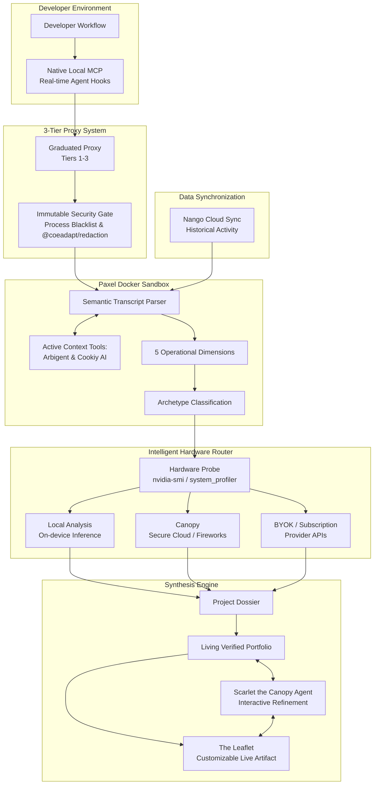

# Portfolio Harness Architecture Specification

**Status:** DRAFT
**Date:** 2026-09-15

## 1. Overview and Core Philosophy

We are building a **Portfolio Harness**, not a generic agent evaluation harness. Its singular objective is to observe workflows and compile a living, verified, and quantifiable developer portfolio. 

Instead of relying solely on static source code repositories, this harness processes the **semantic communication layer** (agent transcripts, workflow logs, and AI interactions) to evaluate developers across five operational dimensions and classify them into functional archetypes (e.g., The Architect, The Sprinter, The Quality Guardian).

## 2. Architecture Diagram

## 3. Integration and Sync Architecture

### 3.1 Historical Cloud Sync (Nango)
Nango will be used for continuous, historical data synchronization from external cloud integrations (e.g., GitHub, Jira). 
- **Purpose**: Backfill historical activity and establish the base portfolio history.
- **Ingestion**: Normalizes varied external webhooks/APIs into the `ProjectDossier` structure (`buildFactList()`) to ensure facts are mathematically grounded and immutable.

### 3.2 Local Agent Hooks (Native Local MCP)
Local Model Context Protocol (MCP) will be used to provide zero-cloud, privacy-preserving hooks into on-device agent workflows (e.g., Claude Code, Cursor).
- **Purpose**: Capture the "live" semantic communication layer in real-time as the developer works, without exfiltrating raw development data to third-party clouds.

## 4. The 3-Tier Graduated Proxy System

To capture agent and user activity safely, we introduce a graduated proxy system. Users can easily scope what the proxy intercepts, providing flexibility and trust.

### 4.1 Proxy Tiers
- **Tier 1: Surgical AI** - Scoped to strictly defined files, single scripts, or narrow processes.
- **Tier 2: Dev Workspace** - Scoped to the IDE, terminal, and designated development directories.
- **Tier 3: Full Computer** - Global OS-level access for observing broad workflow context.

### 4.2 The Immutable Security Gate
Regardless of the Tier chosen (even Tier 3), an Immutable Security Gate sits inside the proxy to guard critical/sensitive processes.
- **Hard Process Blacklist**: Automatically blocks interception of specific system or secure processes (e.g., credential managers, secure enclaves).
- **Redaction Firewall (`@coeadapt/redaction`)**: Uses the existing local extraction privacy boundary (`seed.json`) to aggressively scrub PII, secrets, and company names from transcripts and network payloads *before* they are analyzed.

## 5. Paxel-like Sandboxing and Evaluation (Docker)

To evaluate the semantic communication layer safely, we rely on a containerized architecture managed by the existing `docker-manager.ts` in the desktop app.

### 5.1 Transcript Parsing and Dimensions
The sandbox processes agent transcripts and workflow logs to score the developer across 5 dimensions:
1. **Steering**: How well the user guides the AI.
2. **Execution**: Delivery and implementation speed/accuracy.
3. **Engineering**: Code quality, architectural soundness.
4. **Product Instinct**: User-centric design and problem-solving.
5. **Planning**: Forward-thinking and structural organization.

### 5.2 Active Context-Gathering Tools
To deeply understand the developer's work, the harness acts autonomously within the sandbox, utilizing specialized tools to gather context beyond static code:
- **Arbigent (UI/Execution Evaluation)**: The harness uses Arbigent to launch the compiled application and visually interact with the UI. This provides the harness with real context on the execution quality, UI responsiveness, and how the semantic code translates to the actual user experience.
- **Cookiy AI (Product Instinct Evaluation)**: The harness uses Cookiy to simulate user research or analyze the UX/product decisions. This allows the harness to contextually understand the developer's product instinct by testing the workflows against synthetic user behavior or qualitative research frameworks.

### 5.3 Archetype Classification Engine
Based on the dimensions, the system categorizes the developer into functional archetypes such as:
- **The Architect** (High Planning/Engineering)
- **The Sprinter** (High Execution)
- **The Quality Guardian** (High Engineering/Product Instinct)

## 6. Intelligent Hardware Detection & LLM Routing Strategy

Processing semantic data (transcripts) requires LLM inference. To balance privacy, cost, and capability, the system will dynamically route workloads based on local hardware capabilities.

### 6.1 Hardware Probing
Leveraging the existing onboarding flow (`GET /runtime/eligibility` via `nvidia-smi` / `system_profiler`), the system determines if the host hardware (GPU/RAM) is capable of local analysis.

### 6.2 User Experience and ETA Calculation
The UI will proactively present the user with the hardware capabilities:
- **Limits**: What the local hardware can handle (e.g., processing throughput limits).
- **ETA**: Estimated time to complete the portfolio analysis locally vs. via cloud alternatives.

### 6.3 Three Execution Pathways
The user is presented with three routing options:
1. **Local Analysis (On-Device)**
   - Requires sufficient hardware.
   - Maximum privacy (no egress).
   - Expected to be slower; suitable for asynchronous background processing.
2. **Canopy (Secure Cloud / Fireworks)**
   - Fast, secure cloud models.
   - User retains data ownership (zero-retention policies on the API level).
   - Default recommendation for users without adequate local hardware.
3. **Bring Your Own Key (BYOK) / Subscription**
   - User provides their own API keys (OpenAI, Anthropic) or uses an active subscription.
   - Maximum model capability, bound by the provider's privacy policy.

## 7. The Synthesis Engine (`Coeadapt2`)

Once the local Harness and Paxel Sandbox have evaluated the semantic transcripts and extracted context using active tools, the data flows into the Synthesis Engine to generate the final recruiter-grade portfolio.

### 7.1 The Project Dossier
The gateway to the Synthesis Engine is the `ProjectDossier`. 
- Data streams from Nango, the Local MCP proxy, and the Paxel Sandbox are merged into a canonical list of numbered facts (`buildFactList()`).
- The dossier acts as the single source of truth, carrying the developer's 5 operational dimension scores and archetype classifications alongside concrete metrics.

### 7.2 Third-Party vs. First-Party Claims
The Synthesis Engine applies strict rules on how it treats sources:
- **Historical Data (Nango / Web Import)**: Treated as unverified third-person data. The engine scrubs any unverified "Problem/Solution/Impact" claims, relying strictly on neutral facts.
- **Harness Data (Local MCP / Paxel Sandbox)**: Treated as verified first-party data. Because the proxy and sandbox actively observed the execution (or used tools like Arbigent/Cookiy to prove it), the engine allows these sources to confidently claim authorship and define the Problem/Solution/Impact triads.

### 7.3 Strict Numerical Grounding
When the LLM drafts the portfolio, the Synthesis Engine intercepts the output to run a `validateSynthesizedContent()` check.
- The LLM is mathematically restricted from "hallucinating" claims.
- If the LLM generates a metric (e.g., "reduced latency by 30%"), that exact number must exist in the `ProjectDossier`'s extracted facts.
- This guarantees that the final compiled portfolio is an irrefutable, deeply grounded reflection of the developer's actual semantic workflow and sandbox evaluation.

### 7.4 Scarlet: The Interactive Portfolio Agent
While the Synthesis Engine can compile the portfolio autonomously, the user is not left out of the loop.
- **Interactive Refinement**: The user can build and refine their live portfolio locally or with the help of **Scarlet**, the Canopy agent.
- **Collaborative Editing**: Scarlet acts as a collaborative AI partner, helping the user tweak narratives, emphasize certain operational dimensions (e.g., highlighting "The Architect" over "The Sprinter" for a specific role), and refine the grounded claims without violating the strict numerical boundaries.

### 7.5 The Leaflet: The Live Portfolio Artifact
The output of the Synthesis Engine is surfaced to the user as the **Leaflet**, a dynamic, side-by-side interactive artifact (similar to Claude Artifacts).
- **Rich Media & Proof of Work**: The Leaflet embeds active context from the sandbox. It renders interactive radar charts of the 5 operational dimensions, looping visual replays of Arbigent UI tests, and Cookiy UX metric widgets.
- **Agentic Customization via MCP & Skills**: The heavy theming and layout customization is not hardcoded into the UI. Instead, this capability is exposed to the user's agents (like Scarlet) via a dedicated **MCP connector** and a specialized **Antigravity Skill**. The agent uses the MCP tools to dynamically inject CSS, swap React components, and repaint the Leaflet in real-time based on user requests, ensuring the presentation layer is entirely decoupled and infinitely extensible.
- **Live Shareable State**: The Leaflet is a living web component. Once exported or shared via a link, it remains connected to the developer's harness, automatically updating its verified facts and visual proofs as the developer completes new work.
