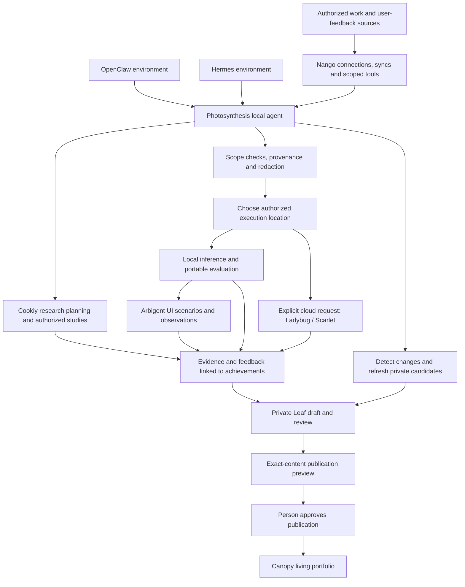

# Foliage Portfolio Harness Architecture Specification

**Status:** Revised design specification; implementation acceptance pending
**Date:** 2026-09-16
**Lineage:** Coeadapt was the previous iteration of Foliage. Its concepts and code are migration inputs, not a separate product in this architecture.
**Source:** [Original draft](2026-09-15-portfolio-harness-original.md), preserved unchanged; owner clarification on 2026-09-16.

This specification owns the portfolio-harness feature design within the existing
[canonical architecture](../architecture.md). It does not introduce a second system map,
portfolio database or set of applications. Requirements below describe intended behavior;
[progress](../progress-tracker.md) records what has actually been implemented and verified.

## 1. Purpose: evidence of achievement

Foliage turns work, reasoning and observed results into a living portfolio. The meaningful
unit is an achievement: the problem, the person's contribution, decisions, experiments,
AI assistance, difficulty and outcome. Code, conversations, tests, media and user feedback
supply evidence for that account. Activity volume alone does not establish capability.

Photosynthesis performs the preparation: it gathers authorized context, searches for relevant
feedback, relates evidence to achievements, drafts narratives and refreshes the private Leaf.
The person corrects consequential ambiguities and decides what to publish. Normal onboarding
is a connection and review flow, not a request to manufacture JSON or upload publication files.

## 2. Responsibilities and deployment boundaries

| Component | Responsibility |
|---|---|
| Photosynthesis | Local portfolio agent operating within the owner's OpenClaw or Hermes environment; collection, feedback discovery, synthesis and private review |
| OpenClaw / Hermes connections | Direct host integrations exposing authorized sessions, artifacts, source-search tools and lifecycle events to Photosynthesis |
| Nango | Selected external integration layer for account connections, credentials, incremental sync, webhooks and scoped agent tools |
| Cookiy user-research skill | Research planning, synthesis, and authorized real-participant or explicitly synthetic studies |
| Arbigent | Selected UI-testing observer for runnable application workflows and retained test evidence |
| Portable evaluation runtime | Isolated execution and replaceable observers producing bounded, inspectable results |
| Leaf | One person's canonical private portfolio, achievements and linked evidence; named views segment roles, companies and projects |
| Leaflet | A constituent artifact/evidence item with context, citations and presentation, not the entire portfolio |
| Canopy | Hosted publication, admitted public reading and current publication authority |
| Ladybug / Scarlet | Cloud-only portfolio assistance; Scarlet is the individual agent identity, not a second local Photosynthesis |

Photosynthesis exists in the connected agent environment; Foliage must connect directly to
it rather than requiring a parallel agent and duplicate memory. The existing CLI and local
studio remain entry points into the same candidate and review contracts. A host adapter
must not create a competing promotion or publication path.

## 3. Direct OpenClaw and Hermes integration

Provide a Photosynthesis skill/tool integration for each host, backed by one versioned local
contract. Prefer the host's supported tool, event and session interfaces; use MCP where the
host supports it. Exact endpoints and installation mechanisms must be verified against the
installed host versions before implementation; this document does not assert existing APIs.

The connection should negotiate capabilities, bind the owner/workspace and display the
actual execution location. It supplies only the selected session/artifact references and
source tools. Photosynthesis can then:

- discover permitted projects, sessions and artifacts;
- consume incremental events and reconcile missed events from a durable cursor;
- read selected context and search authorized feedback sources;
- request an authorized evaluation and ingest its observations;
- propose achievement, citation and media changes in the existing review queue;
- expose progress, missing evidence, cancellation and connection health.

Events need a version, host and workspace identity, stable event/source IDs, observation time,
revision or digest, and scoped artifact references. Store checkpoints locally; deduplicate
retries across hosts by retained source identity, not title similarity. Restart and reconnect
must preserve human edits, source exclusions and pending review. Revocation stops further
reads; unavailable hosts remain visibly disconnected rather than reporting no work.

An agent running on a remote host is not on-device merely because the connection is called
local. Report host location and model routing separately. A host's cloud-model configuration
must not silently receive private Photosynthesis evidence under an on-device promise.

## 4. Capture, feedback discovery and impact

Capture has explicit scopes: selected artifacts/session, selected development workspace,
and optional broader device observation. Broader observation is not the default and requires
separate platform permission, source exclusions, revocation and an implementation threat model.
Supported host integrations precede general interception of computer activity.

Photosynthesis must actively search for user impact in authorized sources: product feedback,
support issues, project discussions, interviews, research notes, app reviews and permitted
communication archives. Nango is the selected integration layer for external accounts,
continuous synchronization and scoped source tools. Direct host tools retain responsibility
for local sessions and artifacts. A connected account does not authorize
searching unrelated projects or sending messages to customers.

For each relevant feedback item, retain source identity/link, author or permitted anonymized
identity, date, exact supporting excerpt or locator, product/version context, capture digest,
access restrictions and the proposed achievement relationship. Distinguish customer statements,
the portfolio owner's account, observed behavior and agent interpretation.

The agent links feedback to the work using release, feature, project and timing context. It
must preserve ambiguity, negative feedback and contradictory findings. Reposts and duplicate
tickets are not independent corroboration. Ask a narrow question when attribution cannot be
resolved from evidence. Absence of accessible feedback means impact is not yet established.

A customer saying a workflow saved time supports an attributed customer report. A measured
latency improvement supports a technical result. Neither alone proves revenue, adoption or
causation. Stronger outcome claims need the corresponding feedback or operational evidence.
Searching, retaining privately and publishing a quotation are separate permissions; redact
identities and confidential context before any approved outward use.

### 4.1 Nango: the external connection and synchronization layer

Nango is central to hands-off onboarding: connect a source once, select its permitted scope,
and keep relevant work and feedback current. Its documented capabilities include authentication
and token refresh, incremental syncs, webhooks/triggers and integration tools exposed to agents.
These are distinct from Foliage's own identity and publication authority.
[Source: Nango official overview, https://nango.dev/, inspected 2026-09-16.]

The intended flow is Canopy connection UI → actor-bound Nango connection → scoped sync/tool
requests → source records with provenance → Photosynthesis candidates. Clerk remains login;
Nango manages external-source connections, not Foliage ownership. Keep Nango credentials and
hosted orchestration in the cloud plane. OpenClaw/Hermes Photosynthesis obtains only permitted
records or scoped tools through an authenticated boundary, never a server master credential.
Local-only collection remains usable without Nango or a Canopy account.

Implement source adapters for selected work and feedback systems (for example GitHub, issue
trackers and support/discussion sources) after checking the actual connector capabilities and
requested scopes. Provider availability does not imply a ready-made Foliage sync or search.
Define per-source models, pagination/checkpoints, incremental updates, deletions, stable IDs,
provider timestamps, source locators and access restrictions. Bind every connection and record
to the current actor/tenant; reject foreign connection IDs. Verify webhook authenticity using
the chosen deployment's supported mechanism, deduplicate delivery, and reconcile missed events.

The user sees connected, syncing, current, reconnect-required, paused and failed states plus
last successful observation. Disconnection stops jobs and agent tool access; deletion and
retention follow the applicable evidence policy without falsely rewriting published history.
A cloud sync processes data outside the device: disclose the Nango deployment and payload scope.
Do not describe a Nango Cloud path as zero-cloud or silently upload local transcripts into it.

### 4.2 Cookiy: research that supplies missing human context

Use the Cookiy user-research skill in Photosynthesis's connected agent environment to design
research questions and interview guides, synthesize existing authorized transcripts, and
prepare studies when feedback is missing. Its documented scope includes qualitative interviews,
quantitative surveys and studies with real or synthetic participants through Cookiy AI.
[Source: https://github.com/cookiy-ai/user-research-skill, README inspected 2026-09-16.]

Photosynthesis should first search retained feedback through Nango and host sources. Cookiy
can synthesize that material into cited findings. When it is insufficient, propose a focused
study tied to an achievement or product question. Launch, recruitment, participant contact,
budget and third-party transcript transfer require the corresponding explicit authorization;
search permission does not authorize contacting people or spending on research.

Import study IDs, question/guide versions, participant kind, permitted participant references,
collection dates, sample size, source transcript/response locators, excerpts, limitations and
findings. Keep real-participant findings and synthetic hypotheses separate in storage and UI.
A real participant is not automatically an existing customer: preserve recruitment criteria,
product exposure and study context. Cookiy synthesis supports an attributed research finding;
it does not independently establish business impact. Retain negative and conflicting findings.
The exact host installation and result-import interface still need implementation verification.

## 5. Privacy and execution routing

Apply source allow-lists, process exclusions, least-privilege access and redaction before
analysis, with an additional fail-closed check before outward transfer. Secret-bearing
processes remain excluded. Redaction is a defense, not a guarantee that broad capture is safe.
Keep raw transcripts and private feedback local by default; operational logs contain safe
status metadata and evidence references rather than raw prompts or credentials.

Choose location before inference or execution:

1. **Local:** authorized on-device model and local evaluation; no automatic cloud fallback.
2. **Canopy / Ladybug:** explicitly admitted context sent through the cloud boundary, using
   configured providers such as Fireworks.
3. **BYOK:** an explicitly configured provider route with visible destination and cost policy.

Probe available compute and model readiness before offering a local route. Show estimates only
when supported by measurements; otherwise state that timing is unknown. Provider retention,
residency and API entitlement require verification. A consumer subscription is not assumed to
supply API access. Do not widen the frozen CoS product surface to implement these features;
reuse suitable adapters through Photosynthesis's existing contracts.

## 6. Portable evaluation and observation

Reuse the existing evaluation contract: prepare → execute → observe → evaluate → emit evidence.
Bind every run to the exact revision, scenario, image, allowed actions, time/resource limits,
network policy and selected environment. Keep private code in that environment and signing
keys outside the workload. Record exit, timeout, cancellation and cleanup outcomes honestly.

Local Docker is the initial runtime. Arbitrary third-party cloud execution needs the separately
accepted sandbox boundary. Arbigent is the selected UI-testing observer; Cookiy supplies
the separate user-research workflow above. Keep both behind stable contracts so implementation
can evolve without changing evidence identity. UI observations and benchmarks support bounded
execution claims; synthetic research cannot substitute for real feedback.

Evaluation proves only what the observation supports. A signed result establishes issuer and
integrity under its trust contract; it does not automatically prove personal contribution,
customer impact or independent measurement. Adaptive agent execution requires a bounded
execution grant; source-read permission alone does not authorize running generated commands.

### 6.1 Arbigent: exercise the application and retain what happened

Photosynthesis prepares a scenario linked to a project, exact revision/build and achievement.
The evaluation runtime runs that authorized scenario through Arbigent against an isolated test
account and a supported browser/device environment. Scope the goal, allowed applications and
origins, step/time/cost limits, model destination, setup and cleanup before execution. An AI
scenario can choose actions dynamically, so its bounded grant must cover that behavior.

Arbigent documents scenario dependencies, YAML/CLI execution, screenshots, image assertions,
MCP tool access and machine-readable `arbigent-result/result.yml` alongside an HTML report.
Import these through a version-pinned adapter into Foliage's existing result envelope. Preserve
scenario/model/tool versions, environment, assertions, attempts, failures, timings and artifact
digests. Retain video only when the selected runner actually captures it; never imply every
run produces a replay. MCP tools are allow-listed per scenario, not inherited wholesale.
[Source: https://github.com/takahirom/arbigent, README inspected 2026-09-16.]

The upstream README lists Android and iOS end-to-end testing and lists Web/Chrome support
with testing not yet conducted. Require a real Foliage browser pilot before claiming web
acceptance; unavailable device/browser support must be reported as unavailable. Screenshots
and UI trees sent to a model are data transfers even when the test runner is local.

Use the observer both to evaluate authorized portfolio projects and to test Foliage itself.
An initial Foliage scenario covers connection → private preparation → evidence preview with
no publication. Later authorized scenarios cover publication updates and withdrawal. Report
assertion failure, environment failure and observer uncertainty separately; a model saying
“passed” without retained observations is not acceptance. Compare equivalent before/after
runs only when their environment and measurement definitions support the comparison.

## 7. Evidence-grounded synthesis

A project dossier is a derived view of the existing Leaf, candidate and evidence contracts,
not a separate authority store. It assembles the problem, decisions, alternatives, failed
experiments, personal and AI contributions, implementation, observations and user feedback.
Each proposed claim links to its specific supporting sources and explicitly states uncertainty.

Photosynthesis organizes demonstrated work across steering, execution, engineering, product
judgment and planning. These are qualitative lenses for evidence, not numerical person scores,
radar-chart ratings or fixed archetypes. Actual measurements of systems remain useful.

Validate numbers against their subject, units, time interval, baseline, calculation and source.
A number occurring somewhere in a transcript is insufficient. Preserve the exact cited spans
and measurement context. Unsupported claims remain drafts or are omitted; generated prose
never becomes its own evidence. Source revisions can invalidate support and must flag affected
claims for review without silently overwriting the person's account.

## 8. Portfolio experience and agent refinement

Lead with biography, direction and passions, then keystone achievements and the compound-leaf
timeline. Leaflets reveal summaries, logos, media, decisions and claim-level evidence as readers
explore. Offer notable-work curation and newest/oldest chronology without capability scoring.
Named views let people segment companies, roles and projects without duplicating identity.

Photosynthesis refines the private portfolio in the host environment. Scarlet assists in
Canopy with only admitted context. Expose bounded presentation tools for themes, layouts,
media and evidence emphasis; do not allow arbitrary generated scripts or unrestricted CSS to
escape the renderer's security, accessibility or token contracts. Keep an accessible reading
path alongside 3D enhancement. Private and public tools enforce different access scopes.

Show what was found, which claim it supports, what is uncertain, where processing occurs and
what changed. Let the agent handle mechanical preparation; ask the person only for meaningful
scope, ambiguity and publication decisions. No invented media, testimonials or empty-state data.

### 8.1 User and Scarlet customization — required product scope

The portfolio and every leaflet must be highly customizable by the person, directly or through
Scarlet (Ladybug). This is a core authoring capability, not a fixed-template renderer with a
chat window. Direct manipulation and natural-language requests use the same versioned editing
operations and canonical saved state. Photosynthesis can apply the same local operations;
Scarlet uses scoped cloud tools and sees only context authorized for that session.

| Scope | Controls the person and authorized agent share |
|---|---|
| Whole portfolio | Intro/bio/direction, hero composition, approved portrait and cover media, typography and palette presets, spacing/density, section composition and ordering, featured achievements, navigation and contact presentation |
| Named Leaf view | Company/role/project selection, view introduction, curated highlights, default notable/newest/oldest ordering and permitted view-level presentation overrides |
| Individual leaflet | Display title, summary and narrative structure, role and contribution, cover/logo, media gallery and available test replays, captions, evidence presentation, relationships and layout variant |
| Compound leaf | Supported arrangement, source/category color encoding with a legend, information density, expansion behavior and motion intensity; preserve meaningful dates and keyboard/touch access |

Provide a live preview, selection/inspector controls, reusable presets and per-leaflet overrides.
Defaults inherit portfolio → named view → leaflet; resetting an override restores inheritance
without deleting authored content. Reuse the existing achievement editor, curation, named views,
media and timeline model. Inspect their operations before adding a missing field or tool; do
not build a parallel Scarlet editor, new portfolio store or alternative evidence schema.

An instruction such as “make this more editorial, lead with my agent-memory project, and turn
this leaflet into a visual case study” becomes a bounded edit set. Show the result and changed
fields in the preview. Reversible edits within the granted session scope should apply without
repeated confirmation. Support undo/redo, reset and version comparison; mark fields the person
has chosen to preserve so background synthesis cannot overwrite them.

Each edit set identifies the selected Leaf/view/leaflet IDs, allowed field changes and expected
base revision. Validate it through the same domain operations as manual edits; apply the set
atomically, reject stale/conflicting edits and retain recoverable draft work. Keep an edit
history identifying manual versus agent changes. Undo is a new revision, not deletion of history.
The rendered preview and publication must consume the same admitted presentation state.

Customization may change how evidence is explained and presented; it cannot manufacture
support, change source dates or proof status, detach an existing claim from its citation, or
expose withheld media. Renaming a display title does not rename the retained source artifact.
Agent-proposed factual changes retain supporting citations or an explicit unsupported-draft
state. No person scores arise from curation or visual prominence.

Creative range should come from supported design tokens, layout components and media blocks.
Maintain private/night and published/day surfaces, self-hosted assets, reduced-motion behavior
and readable non-WebGL content. Customization does not grant arbitrary script execution or
external resource loading. Adding bespoke components requires a separate reviewed extension
contract. Public visitors cannot edit the owner's portfolio through Scarlet; owner identity
and grants govern every tool call. Saving private design changes is separate from publishing.

Acceptance must demonstrate the same change through manual controls and Scarlet, persistent
reload, inheritance/reset, undo/redo, stale-edit refusal, preserved citations and owner edits,
unauthorized visitor refusal, and matching desktop/mobile/public rendering after explicit
publication. Current basic authoring is a reuse point; these full customization capabilities
are required scope and are not yet claimed implemented.

[Source: User, portfolio and leaflet customization requirement, 2026-09-16.]

## 9. Continuous updates and observability

Incremental host/source updates refresh private candidates automatically within standing
scope. Preserve corrections and link new feedback to existing achievements. Public replacement
uses the existing exact-content approval and receipt contract; a live link does not authorize
unreviewed publication. Withdrawal applies to content and media under current Canopy authority.

Trace connection → collection → feedback search → evaluation → claim draft → review → receipt
with correlation IDs and evidence digests. Report retry, partial access, provider failure,
revocation, stale evidence and uncertain remote outcomes separately. Never collapse a failed
search into “no impact.” No raw private transcript or feedback is required in operational logs.

## 10. Implementation ownership and acceptance

Extend existing units rather than starting a parallel build plan:

| Scope | Owning application / existing units | Required acceptance |
|---|---|---|
| OpenClaw / Hermes connection and capture | [Photosynthesis](../apps/photosynthesis.md), [capture](../apps/capture.md); 09, 10, 33 | Each real host connects, resumes after restart, deduplicates and honors revocation |
| Nango source connections | Canopy cloud integration adapter / Photosynthesis; 09, 10, 16, 30 | Real scoped connection, initial and incremental sync, foreign-actor refusal, reconnect, deletion and revocation |
| Cookiy research | Photosynthesis / evaluation adapters; 11, 12, 26 | Cited findings from authorized transcripts; real/synthetic labeling; study launch and budget gates |
| Arbigent testing | Evaluation runtime; 26, 27 | Real application scenario with imported result and screenshots, failures retained, cleanup and browser acceptance |
| Feedback search and achievement synthesis | Photosynthesis / [Leaf](../apps/leaf.md); 09, 11, 12 | Actual authorized feedback supports an attributed claim; missing, duplicate and conflicting feedback remain honest |
| Evaluation | [Runtime](../apps/evaluation.md); 26, 27 | Real authorized run, artifact provenance, bounded execution and cleanup |
| Cloud refinement | [Ladybug](../apps/ladybug.md); 16–18 | Only admitted context leaves the host; unavailable routes do not silently fall back |
| Presentation and publication | Leaf / [Canopy](../apps/canopy.md); 13, 23, 24 | Claim citations and media work; private updates preserve edits; approved replacement retains the public address |
| Operational visibility | Existing observability unit 30 | One trace follows a real update, including failure and recovery, without leaking private content |

Audit Coeadapt's `docker-manager.ts`, redaction, eligibility, dossier and synthesis code as
predecessor assets. Reuse only after checking compatibility, licensing, privacy and tests;
legacy names do not establish current Foliage implementation. The direct host integrations and
feedback-discovery loop above are required design direction, not claimed completed features.

[Source: Owner-supplied draft and direct clarification, 2026-09-16; Foliage context contracts.]
