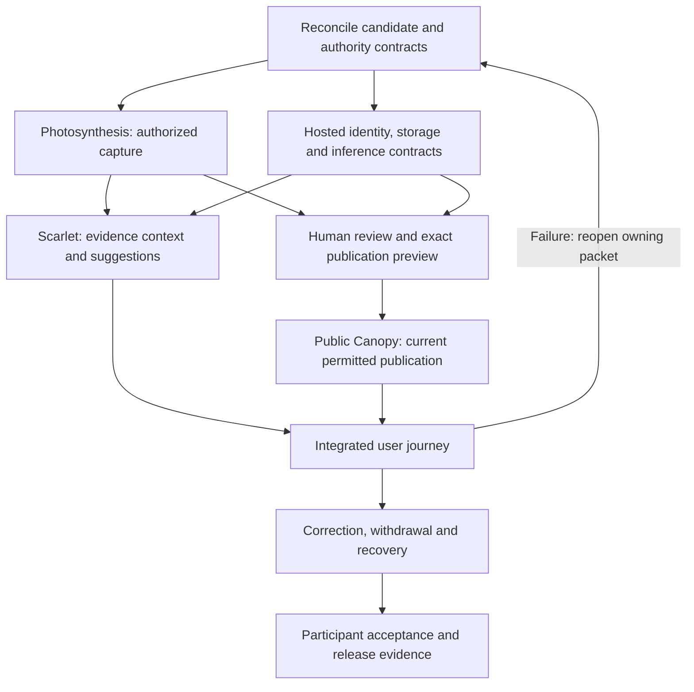

# Scarlet delivery workflow

Owner direction: finish Photosynthesis, Scarlet (the ladybug agent), and public Canopy as
one functional journey. This is the active implementation sequence for that slice of the
[complete build plan](PORTFOLIO-SCALE-BUILD-PLAN.md), not a new scheduler or a claim of release.
The [acceptance matrix](PORTFOLIO-SCALE-ACCEPTANCE.md) and existing launch gates still apply.
Asana remains the execution-status system; reuse the task links in the build plan.

## The outcome

A person connects a source they may use, captures real evidence with Photosynthesis, asks
Scarlet to explain or improve a candidate, reviews and approves the exact wording, previews
what will be public, deliberately publishes, and opens the resulting Canopy page outside
their private session. They can later correct or withdraw it, and public reads honor that
change. A second person can understand the evidence and its limits without assistance.

Scarlet is the individual assistant. Photosynthesis is the local capture/drafting process.
Canopy is the public reading destination for deliberate publications. Scarlet's private
workspace and hosted inference must not expose private conversation or source material on
Canopy. Pango's forest-protection role does not grant Scarlet access or publication rights.

## Execution record

[Execution started on 2026-09-11](SCARLET-EXECUTION-2026-09-11.md). The isolated integration
candidate incorporates existing full-build work missing from this checkout. See that record
for completed checks, fixes, remaining implementation and hosted acceptance dependencies.

## Observed starting point

These are source observations from this checkout, not live deployment acceptance.

| Area | Existing implementation to extend | Remaining evidence or integration |
|---|---|---|
| Photosynthesis | `apps/photosynthesis/src/gather.ts`, drafting/pipeline modules; `packages/photosynthesis/src/cells.ts` and `promote.ts`; `apps/leaf/cells.mjs` | Connect capture, authoritative cells, existing workflow ownership and review without losing decisions. Background capture is documented as disabled; inspect the existing scheduler work before enabling it. |
| Scarlet | `apps/leaf/src/scarletWorkspace.ts`, `scarletContext.ts`, `scarletTools.ts`, `scarletRun.ts`, `scarletAnswerReview.ts`; `/scarlet/workspace` and `/scarlet/run` | Current model transport is loopback Ollama. Tools are deterministic user-selected reads; suggestions are copied, not applied. Hosted Scarlet, authorized context transfer and durable operation recovery need an integrated implementation. |
| Public Canopy | `apps/canopy/server.mjs`, `publishedLeaf.ts`, `publicationInventory.ts`, publication mutation/lock modules and public renderers | File-backed reader and separate management code exist. Prove hosted admission, ownership, durable authority, current-revision reads, deployment packaging and withdrawal across every public surface. |
| UI | Shared controls and token foundation; private review/publish links into Scarlet | Complete all transitions and failure states, including return from Scarlet with a suggestion and return from publication with a receipt. |

The accepted build calls Scarlet cloud-only; the current implementation is local. Packet W1
must record the migration contract explicitly. Do not silently change the accepted target or
relax the open package's loopback/egress rules to make a hosted model work. Put hosted adapters
in the appropriate closed plane and preserve standalone local Photosynthesis.

## How the workflow chooses work

At the start of each work session and after every accepted change:

1. Read this workflow, the linked build/acceptance records, current findings and working-tree
   changes. Identify the exact candidate and existing operators before editing shared files.
2. Refresh each relevant packet's evidence. Use `unknown`, `ready`, `in progress`, `blocked`,
   `review`, `accepted`, or `reopened`. Source presence alone never means accepted.
3. A packet is ready only when its required dependency contracts are accepted, its file owner
   is available, and it has a concrete failing journey or missing deliverable to resolve.
4. Choose the earliest ready packet below. A privacy, attribution, publication or withdrawal
   defect affecting this slice takes precedence over additional features. Do not fix unrelated
   findings merely because they exist; keep required repository gates honest.
5. Implement one bounded change, run its focused checks, and attach the observed result to
   the existing task. Reuse existing stores, source adapters, approval controls and schedulers.
6. Request independent review at the relevant trust boundary, then integrate and run the
   repository gates. Mark accepted only when the packet's outcome is observed.
7. On failure, reopen the owning packet and mark dependent acceptance stale. Continue another
   ready packet if one exists. If none exists, report the exact dependency and next action;
   never substitute fabricated evidence or an automatic approval.

Changes to source or grants reopen W2/W3; changes to model/context reopen W4; changes to
publication authority or storage reopen W5–W7; renderer-only changes reopen affected W6/W7
browser evidence. Re-run only the affected checks until integration requires the full gate.
A changed contract invalidates its dependent packets, not unrelated completed work.

Default to one implementation operator. If parallel work is explicitly authorized, use at
most two implementation lanes plus one integration/review operator, with one writer per file.
W2 and W3 can progress independently after W1; Canopy layout work can progress against the
agreed public projection while hosted admission is built, but cannot be accepted early.

## Work packets

| Packet | Work and dependency | Completion evidence | Existing build mapping |
|---|---|---|---|
| W0 — Candidate | Reconcile current edits, renamed Scarlet files, source-store/workflow work and deployment packaging. No dependency. | Named candidate and worktree inventory; actual `pnpm check` result; known failures attributed; selected deployment contains required workspace assets. | B00 |
| W1 — Contracts | After W0, bind source/subject identity, capture permission, model-transfer permission, review, publication and withdrawal to explicit state. Select hosted identity and inference integration within the accepted architecture. | Recorded payload/authority contracts, owning modules and migration behavior. Raw capture permission cannot authorize inference transfer or publication. Define operation IDs, receipts, unknown outcomes and stale/revoked-state behavior. | B01/B02/B04/B08 |
| W2 — Photosynthesis | After W1, connect authorized sources → authoritative cells → candidates → existing review/promotion. Reconcile existing process ownership before background capture. | Real authorized repository reaches review; repeat capture is idempotent; another repository's pending work survives; denial, retraction, wrong identity and source failure are distinct; no automatic promotion/publication. Stop/restart does not duplicate or lose work. | B03; ST04 |
| W3 — Hosted foundation | After W1, implement authenticated ownership/admission, private immutable objects, transactional authority/receipts and recovery using the accepted hosted architecture. | Two authorized subjects remain isolated; arbitrary signed JSON does not become attribution proof; duplicate operations, changed-body retries, failed staging, lost acknowledgments and unavailable authority have correct outcomes. | B01/B02; AU01–AU03, ST01–ST03 |
| W4 — Scarlet | After W2/W3, connect permitted candidate/Leaf context to hosted inference and bounded assistance. Preserve visible provenance, stop/retry and human decisions. Define an explicit user action for carrying suggestions back into review. | On real evidence Scarlet explains a selected record, proposes wording and prepares a publication explanation; every claim can be assessed against supplied context. Stale/foreign/revoked context is refused; unsupported/rating-shaped answers handled; no suggestion silently overwrites a reviewed draft or publishes. | B03/B08; AU05 |
| W5 — Review and publish | After W2/W3, finish approval → exact public preview → personal publish → receipt → Canopy URL. Consume W4 suggestions through normal review once available. | Editing wording invalidates approval; denied/private/excluded states are explained correctly; exact revision/audience consent is enforced; interrupted publish recovers its original operation; success links to the actual published revision. | B04; UX01–UX03, AU03 |
| W6 — Public Canopy | After W3/W5, finish public routes, permitted listings, leaf/leaflet/media reading, empty/error states and deployment. | A separate reader opens the published URL without the owner's session. Every route reads current authority; no private material enters pages, metadata, listings or assets. Correct/withdraw removes obsolete content from all Foliage-controlled reader paths, including HEAD, downloads and old deployments. | B09/B11; OF01, OF05, OP02–OP05 |
| W7 — End-to-end acceptance | After W4/W5/W6, exercise the entire outcome with real authorized input and a second participant. | Capture → suggestion → review → publish → outside reader → correction → withdrawal, plus failure/recovery cases below, on one candidate. Record participant confusion and actionable defects; release gates remain explicit. | B13 for this slice; AU05, OP07 |

All packets start **unknown** until reconciled against current execution records. The first
next action is W0; no packet is declared accepted by this document. W7 accepts this slice,
not the remaining team, organization, industry or commercial commitments in B00–B13.

## Required journey evidence

| Case | What must be observed |
|---|---|
| No data or permission | Useful empty state and explicit connect/allow action; no seeded portfolio or invented evidence. |
| Capture fails | The actual source cause is visible; prior work remains intact; retry does not duplicate evidence. |
| Inference unavailable, interrupted or wrong | Read/review remain usable; incomplete text stays incomplete; retry preserves the question. Evaluate supported claims against actual sources, not model self-review. |
| Evidence, policy or grant changes | Old context/approval cannot be reused; the user sees what requires fresh review. |
| Publish acknowledgment is lost | Query the original operation receipt; no blind duplicate publication or fabricated success. |
| Storage or authority unavailable | Fail closed; no stale permitted-content fallback. Restore bytes and revocation state consistently. |
| Correct or withdraw | A separate reader can no longer retrieve the withdrawn revision through any controlled surface. Do not promise erasure of copies a reader already downloaded. |
| Real reader | Can explain one concrete capability and what its evidence permits them to conclude; no person score, ranking or implied proof. |

Use existing focused suites for the touched seam: Photosynthesis pipeline/cells/promotion;
Scarlet context/reliability/model/seam; Canopy publish/withdraw/manage/reader/CSP. Run
`pnpm check` on the integrated candidate. No extra build step for the Node applications.
Record actual commands, candidate, results and remaining limitations without copying stale
pass counts into the plan. Existing deterministic gates do not prove live model usefulness,
hosted isolation or participant success; collect those observations separately.

For browser acceptance follow repository browser instructions: one owned tab per agent,
verified listener ownership and measured viewport width. Test keyboard operation, narrow and
wide layouts, retry/cancel, public links and withdrawal. Public Canopy uses day surfaces;
Scarlet/private review uses night. Follow [UI-FOUNDATION.md](UI-FOUNDATION.md), use shared tokens,
self-hosted fonts, measured contrast and honest empty states.

## Work-session handoff

Update the existing task with: packet; candidate; owner; dependency evidence; bounded change;
observed result; unresolved cause; next eligible packet. Reference evidence without copying
private source material into public logs. A blocked task names what must change to unblock it.
This workflow creates no recurring automation and performs no publication by itself.
